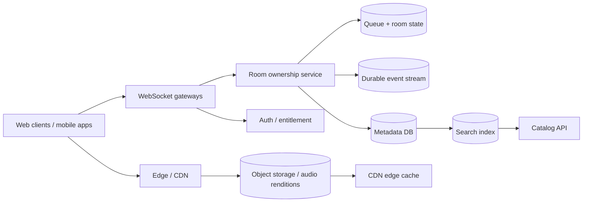
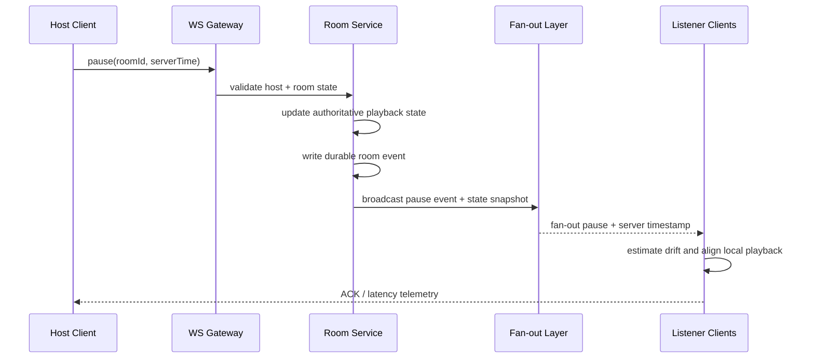

# Music Streaming Architecture Design

## 1. Requirements and assumptions

This design supports a music platform serving 20 million monthly active users, 2 million concurrent listeners at peak, 50 million tracks, and 200,000 open rooms. The system must offer low-latency room control, reliable media delivery, and fast search for both catalogue lookup and room queue operations.

Functional requirements include:

- Track catalogue metadata, ingestion, search, and metadata updates
- Audio delivery through a CDN with signed URLs and adaptive bitrate playback
- Shared listening rooms with host-controlled playback state and queue operations
- Real-time room synchronization for pause, play, seek, skip, and queue changes
- Support for very large rooms without concentrating all traffic on one process
- Observability across routing, cache hit rates, playback startup time, and queue latency

Non-functional requirements:

- Control-plane synchronization target: within approximately 200 ms for authoritative room events
- Playback startup must be fast enough to be perceived as immediate on broadband connections
- Regional outages must degrade gracefully without uncontrolled user-visible failure
- Data should be durable where required, but ephemeral room state can be replicated quickly

Important distinction: the 200 ms objective applies to control-plane synchronization, not absolute audio playback alignment. A host pause command may reach listeners within 200 ms, but the actual moment each device begins decoding and playing audio may differ by tens to hundreds of milliseconds because of network jitter, decode latency, buffering, and local clock drift. The system should therefore optimize for consistent control ordering and server-authoritative state, while clients estimate and correct playback drift locally.

---

## 2. Audio delivery

### Storage and delivery

Audio content is stored in a highly durable object store in multiple regions, with immutable object names for each track version and bitrate. A transcoding pipeline converts source files into standard encodings such as AAC or Opus at multiple bitrates, then stores derivatives in object storage and serves them through a content delivery network.

Recommended flow:

1. Upload raw asset to ingestion system.
2. Transcode to several bitrate ladders and formats.
3. Store each rendition in object storage keyed by track id and quality.
4. Publish metadata and signed playback URLs into the catalogue service.
5. CDN caches hot audio segments and serves them directly to clients.

The backend should not proxy every audio byte. A proxy would add unnecessary cost, latency, and operational risk. Instead, the service emits signed temporary URLs to the CDN layer, where the client requests the closest available replication and the CDN handles scale-out and caching. This reduces backend load and keeps the control plane separate from the media plane.

### Playback startup and adaptive bitrate

Clients should begin playback with a small initial buffer and select the lowest bitrate that satisfies the network. A typical flow is:

- Start with an initial low bitrate for fast start.
- Measure throughput and rebuffer events.
- Increase or decrease bitrate stepwise based on network quality.
- Keep a short playback buffer to absorb jitter while preserving low latency.

Signed URLs keep access control predictable while offloading delivery to edge networks. Caches improve startup time and reduce traffic spikes on origin storage.

---

## 3. Catalogue and search

The 50 million track catalogue needs a metadata store designed for high write volume and flexible querying. A relational store such as PostgreSQL is a good fit for canonical catalogue metadata, ownership, licensing metadata, and transactional updates. Search-as-you-type should be served by a search index such as Elasticsearch/OpenSearch, backed by asynchronously published metadata updates.

Workflow:

- Metadata and relationships are written to the relational database as source-of-truth records.
- A streaming ingestion or async worker updates the search index after validation and deduplication.
- Search is served from a replicated inverted index optimized for prefix and relevance queries.
- Popular tracks and recommendations may use a cache tier or a materialized analytics store.

New releases should be published asynchronously so that the transactional metadata system stays fast while the search layer catches up. For a user typing a search term, the system usually returns cached metadata first and fills in fresher results asynchronously.

---

## 4. Listen Together room synchronization

Room creation and membership

- A room is created with a unique id, host identity, and authoritative room state.
- Membership is stored in a durable data store for room metadata and a memory-resident room state for active sessions.
- Room membership is usually limited to a few thousand listeners, with queue operations and playback commands authorized by the host or room moderator.

Shared queue and skip operations

- Queue state is stored in the room state store and persisted to a durable queue log for auditability.
- Skip votes are counted centrally so the host or server cannot be bypassed by client-side voting logic.
- Queue changes are serialized through the room owner service to maintain ordering.

Host pause/seek behavior

- On host press, the client sends a play/pause or seek command to the room gateway.
- The room service validates the request, checks room authority, and records a server timestamp.
- The room service broadcasts an authoritative state update containing a server-received-at time and a playback position.
- Listeners apply an estimated correction using client-side clock offset and local buffering.

Late joiners

- When a listener joins an active room, the server sends the current playback position, queue metadata, and room state.
- The client aligns to server time using a clock offset estimate and initial playback time offset.
- The client begins from the current authoritative state rather than the last local state.

Server-authoritative room state and event sequencing

- The room service is the sole authority for playback state transitions.
- Each event includes a monotonic event sequence or server-issued timestamp.
- Clients can reorder or discard stale events, but they cannot override server state.
- Slow clients may receive the event slightly later; the server still controls the final state.

This design distinguishes control-plane agreement from actual audio playback alignment. A control event reaching each device within 200 ms does not mean the physical audio waveform is synchronized to the same instant across listeners, because transport and decode delay vary by device and network conditions.

---

## 5. Very large rooms

A room with 5,000 listeners cannot be handled by a single process without risk. The solution is to partition room ownership and use an event fan-out layer.

Recommended design:

- Each room is assigned to a room owner process or sharded service instance.
- The process maintains authoritative room state and a queue of room events.
- WebSocket gateways connect clients and forward messages to the owning room service.
- A hierarchical fan-out pattern sends one message to a shard-local fan-out layer, which relays to the relevant listening socket set.
- For large rooms, the fan-out layer uses batching and backpressure management to avoid a single gateway bottleneck.

For 200,000 open rooms with varying occupancy, room ownership is sharded by room id using a consistent hash rather than assuming all rooms are similar size. Small rooms can share a worker, while a large room is placed on a dedicated shard or replicated service group.

---

## 6. Databases and event processing

### Recommended data placement

Relational database

- User accounts, subscriptions, and entitlement checks
- Metadata for artists/albums/tracks and licensing
- Room metadata and durable queue state
- Payment and subscription state where applicable

Cache

- Hot metadata and recently used complections
- Search results cached by query signature
- Room membership and state snapshots for quick reads

Search index

- Track search and autocomplete
- Large catalogue indexing with asynchronous update streams

Object storage

- Audio files and transcodes
- Artwork and static assets
- Immutable manifests and playback metadata

Durable event stream

- Playback instructions, queue mutations, room state changes, and analytics events
- Replay and auditability for changes that must be reconstructable

Consistency and retention

- User account and ownership data require strong transactional consistency.
- Room state needs low-latency updates with eventual consistency tolerated across listeners.
- Analytics and royalty event streams can be append-only and retained for a longer period with replay capabilities.

---

## 7. Reliability

The platform must continue operating during partial failure. Key scenarios and mitigations:

- Regional outage: fail over to the next nearest region, keep read traffic on cached metadata, and route playback to other edge nodes.
- Node failure: room ownership moves to a replacement instance and clients reconnect to the same room with fresh state.
- Room-owner failure: state is replicated or rapidly reconstructed from durable event logs and room metadata snapshots.
- Rolling deployments: maintain a drain period, route clients to healthy nodes, and keep a bounded reconnect window.
- CDN failure: fallback to alternate edge regions or origin assets while preserving signed URL security.
- Database degradation: serve cached metadata while the write queue drains and mark freshness as degraded rather than silently serving stale state.
- Event-stream backlog: prioritize control events and queue mutations, use backpressure-aware consumers, and shed non-critical analytics when necessary.

The critical rule is not to silently lose confirmed queue or playback updates. If the system cannot guarantee an update, it must surface a degraded state rather than pretend the event succeeded.

---

## 8. Observability

The system should measure the actual user experience, not just server latency. Metrics include:

- Room event delivery latency from server to listeners
- Client playback drift between listeners
- Pause and seek propagation latency
- WebSocket connection failures and reconnect rate
- Queue operation latency
- Audio startup time and rebuffering
- CDN cache hit rate
- Regional dependency failure rates

To measure synchronization realistically, we need client-side telemetry that records server timestamp, local timestamp, and playback offset from the device. This is more useful than only measuring API response time because it reflects the user-visible experience across networks and devices.

---

## 9. Alternatives and tradeoffs

### Alternative 1: Relational DB vs document DB for metadata

Relational DB strengths:

- Strong integrity and joins for licensing and ownership data
- Mature migration and transaction tooling

Document DB strengths:

- Flexible metadata shape for evolving track schemas
- Easier horizontal scaling for some analytics flows

Decision: keep the canonical metadata store relational for correctness and use caches and search indexes for performance-sensitive read paths.

### Alternative 2: Direct room broadcast vs hierarchical fan-out

Direct broadcast is simple but does not scale well for a large room. Hierarchical fan-out spreads load across gateways and fan-out workers and protects the room owner from becoming the single hotspot.

Decision: hierarchical fan-out with room ownership sharding.

### Alternative 3: Durable event log vs ephemeral pub/sub

Ephemeral pub/sub is faster and cheaper for transient room updates, but it loses history after a failure. A durable event log gives replay and auditability for queue and room transitions without sacrificing the majority of the real-time path.

Decision: use durable event logs for authoritative room state and queue mutations, and a fast ephemeral layer for live fan-out.

### Alternative 4: Server-side audio proxy vs CDN delivery

Proxying audio through the backend adds cost and latency while increasing the blast radius of outages. CDN delivery keeps the media path fast and resilient.

Decision: CDN-delivered signed URLs with no byte-level backend proxying.

---

## 10. Failure scenarios and mitigations

1. Single region fails
   - Detection: health checks, CDN error budgets, traffic autoscaling alarms
   - Immediate behavior: reroute listeners to adjacent region and degrade non-critical reads
   - Recovery: restore traffic gradually after health checks pass
   - User impact: brief playback interruption, no silent data loss

2. Room-owner node crashes
   - Detection: heartbeat misses and regional health checks
   - Immediate behavior: promote replacement owner, rehydrate state from durable event log
   - Recovery: reconnect listeners to the new owner
   - User impact: temporary room reconnect, state preserved if durability is intact

3. Queue entry gets lost during reconnect
   - Detection: sequence mismatch or write acknowledgment failure
   - Immediate behavior: reload authoritative queue state from durable store
   - Recovery: reject stale client updates and recompute using server source of truth
   - User impact: queue may refresh once; no silent mutation

4. CDN cache miss on hot track
   - Detection: cache-miss spikes and increased origin requests
   - Immediate behavior: serve from edge or warm new region using prefetch
   - Recovery: allow cache to warm and continue serving from origin if needed
   - User impact: longer startup time, but not full outage

5. Search index falls behind release pipeline
   - Detection: freshness lag or stale result counters
   - Immediate behavior: serve cached results and mark freshness as degraded
   - Recovery: replay metadata update stream and resync search nodes
   - User impact: search may be temporarily stale, not incorrect or missing

6. Large room fan-out overload
   - Detection: gateway queue depth and socket write latency spikes
   - Immediate behavior: shard room to another owner or batch events more aggressively
   - Recovery: rebalance listeners across gateways
   - User impact: minor latency increase, but consistent room state

---

## 11. Three-person team plan

### MVP (build first)

- Core listening room logic with host pause/seek and queue correctness
- Audio CDN integration with signed URLs and adaptive bitrate
- Basic catalogue metadata store and search index
- Room event fan-out and hot-room sharding
- Telemetry for room latency and playback startup

### Postpone for later

- Global active-active room replication across all regions
- Complex recommendation engine and personalized ranking
- Full royalty analytics pipeline and long-term event retention
- Advanced multi-region conflict resolution for edge cases
- Full-scale search relevance tuning and content moderation at huge scale

This gives the team a credible first release that is correct under real-time room pressure while delaying the most expensive global-scale concerns until demand and product validation justify them.

---

## 12. Diagrams

### High-level architecture

### Sequence: host presses pause in room of 5,000 listeners

This architecture keeps the room state authoritative, makes the fan-out layer scalable, and preserves low-latency coordination without assuming all clients decode audio at the same instant.

---

## 13. Summary

The correct architecture is a split between a high-throughput control plane and a large-scale media delivery plane. The control plane handles room ownership, queue changes, and playback state transitions; the media plane uses object storage and CDN distribution for audio bytes. This keeps the platform scalable, strongly correct for room governance, and resilient under partial failure while remaining understandable enough for a three-person MVP team to ship.
